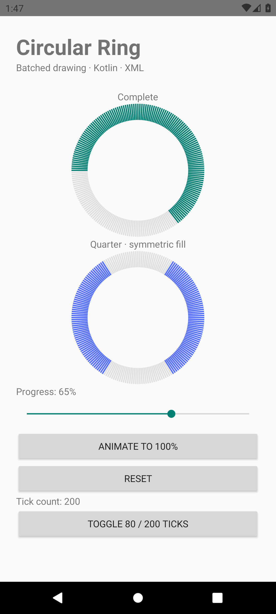

<!-- docs-architect-meta {"schema_version":1,"id":"DOC-README","type":"system-doc","title":"CircularRingProgressview","status":"active","sources":["app/src/main/**","circularringpercentageview/src/main/**","build.gradle.kts","settings.gradle.kts"],"update_when":["API, rendering, build or sample changes"],"relations":[{"type":"documents","target":"REQ-2026-001"}]} -->

# CircularRingProgressview

轻量的 Android 刻度圆环进度组件。Kotlin 实现，支持 XML / Kotlin / Java，提供完整圆环与左右对称填充两种样式。



## 特性

- 缓存刻度端点；进度变化只更新绘制范围，最多两次 `Canvas.drawLines`，每个刻度只绘制一次。
- 进度帧复用坐标数组，不计算三角函数，不执行逐刻度的 Canvas 变换。
- 正确处理 `wrap_content`、非正方形尺寸、padding、0 / 100% 和超出范围的进度。
- 支持进度范围无障碍信息、视图状态恢复、可取消动画和系统动画开关。
- 库只依赖 Kotlin 标准库，不引入 AppCompat、Material 或 Compose；示例独立在 `app`。

Compose 不会自动加速同一组刻度的绘制。当前选择优化后的 View，避免为小组件增加运行时依赖；Compose 应用可通过 `AndroidView` 使用它。

## 环境与构建

Android API **23+**，compile / target SDK **37**。构建使用 AGP **9.5.1**、Kotlin **2.4.21**、Gradle **9.9.1**。构建依赖使用固定版本。

安装 JDK 17+、Android SDK Platform 37（`platforms;android-37.0`）与 Build Tools 36.0.0。在 `local.properties` 中配置 `sdk.dir`，或设置 `ANDROID_HOME`。

```sh
./gradlew assembleDebug assembleRelease lint
./gradlew :app:installDebug
# 启动一个 API 23+ 的设备 / AVD 后：
./gradlew :circularringpercentageview:connectedDebugAndroidTest
```

CI 编译 Debug、经 R8 优化的 Release、测试 APK，并运行 Lint。设备测试需本机 AVD 或连接设备。

## 接入

仓库包含 `:circularringpercentageview` 库和 `:app` 示例，直接作为项目模块依赖：

```kotlin
dependencies {
    implementation(project(":circularringpercentageview"))
}
```

也可生成 AAR 或发布到本机 Maven 仓库：

```sh
./gradlew :circularringpercentageview:assembleRelease
./gradlew :circularringpercentageview:publishToMavenLocal
```

本机发布坐标为 `io.github.stormblue:circular-ring-progressview:2.0.0`；使用时在消费项目添加 `mavenLocal()`。**此版本尚未发布到 Maven Central**，请勿直接假定远程仓库已有此坐标。AAR 位于 `circularringpercentageview/build/outputs/aar/`；手动使用 AAR 时需自行提供 Kotlin 标准库，模块或 Maven 接入会传递该依赖。

## XML

```xml
<com.bluestrom.gao.customview.CircularRingPercentageView
    xmlns:android="http://schemas.android.com/apk/res/android"
    xmlns:app="http://schemas.android.com/apk/res-auto"
    android:id="@+id/ring"
    android:layout_width="160dp"
    android:layout_height="160dp"
    android:contentDescription="下载进度"
    app:crpv_max="100"
    app:crpv_progress="65"
    app:crpv_drawMode="complete"
    app:crpv_tickCount="200"
    app:crpv_tickWidth="2dp"
    app:crpv_tickLength="24dp"
    app:crpv_progressColor="#007F73"
    app:crpv_trackColor="#3367757D" />
```

## 参数

Kotlin 中使用属性，Java 中使用 getter / setter；XML 参数使用 `crpv_` 前缀。

| XML 属性 | Kotlin 属性 / Java setter | 默认值 | 约束 |
|---|---|---|---|
| `crpv_progress` | `progress` / `setProgress` | 0 | 自动限制到 `0..max` |
| `crpv_max` | `max` / `setMax` | 100 | 正整数；降低最大值会同步限制当前进度 |
| `crpv_tickCount` | `scaleNumbers` / `setScaleNumbers` | 200 | `4..2000`；推荐 80–200，过密会重叠 |
| `crpv_tickWidth` | `strokeWidth` / `setStrokeWidth` | 2dp | 有限正数；API 单位为 px |
| `crpv_tickLength` | `ringWidth` / `setRingWidth` | 24dp | 有限正数；API 单位为 px；绘制长度不超过半径 |
| `crpv_progressColor` | `finishedStrokeColor` / `setFinishedStrokeColor` | `#007F73` | ARGB |
| `crpv_trackColor` | `unfinishedStrokeColor` / `setUnfinishedStrokeColor` | `#3367757D` | ARGB |
| `crpv_drawMode` | `drawMode` / `setDrawMode` | `quarter` | `complete` / `quarter` |

`complete` 从左侧（9 点钟方向）沿顺时针填充。`quarter` 从左右两端向上下对称展开，**不是只绘制四分之一圆**。已完成刻度数为 `round(progress / max × tickCount)`；离散刻度在很小的进度下可能仍为 0，且四向填充边界最多相差一个刻度。0% 全部为轨道色，100% 全部为进度色；两种颜色互不叠加。

无效的 max、刻度数、尺寸抛出 `IllegalArgumentException`。`wrap_content` 的期望内容尺寸为 160dp，再加 padding；父布局约束优先。非正方形内容区内居中绘制圆环；尺寸过小时半径收缩到 0。

## Kotlin / Java

所有更新都在主线程执行。控件不主动循环刷新；无需动画时直接赋值。

```kotlin
ring.max = 200
ring.progress = 75
ring.drawMode = CircularRingPercentageView.DrawMode.COMPLETE
ring.animateProgressTo(160, durationMillis = 600)
// 新动画会取消旧动画；直接设置 progress、改变 max 或移出窗口也会取消动画。
ring.cancelAnimation()
```

```java
ring.setMax(200);
ring.setProgress(75);
ring.setDrawMode(CircularRingPercentageView.DrawMode.COMPLETE);
ring.animateProgressTo(160, 600L);
```

设置稳定的 `android:id` 才能通过 Android 视图层级保存和恢复参数。动画恢复时保留当前进度，不自动重启动画。使用 `contentDescription` 提供进度的业务含义，系统无障碍节点另行暴露当前值与最大值。

Compose 已有工程可在 `AndroidView(factory = { CircularRingPercentageView(it) }, update = { it.progress = progress })` 中使用。库不包含 Composable API。

## 性能与测试

几何缓存仅在尺寸、padding、刻度数、刻度宽度 / 长度或模式变化时重建，内存为约 `tickCount × 16` 字节的端点数组。进度更新不触发布局；0% / 100% 只需一次批量绘制，其他进度最多两次。

设备测试覆盖范围与非法值、0 / 50 / 100% 像素、两种模式、几何更新、测量约束、参数状态恢复与无障碍范围。另包含逐刻度变换与批量绘制的软件 Canvas 耗时对比，只输出观测值，不设容易受设备噪声影响的速度断言。该测试不能代表真机 GPU 帧率。

示例提供滑动进度、动画、重置、80 / 200 刻度切换、深色主题和可滚动布局。组件行为见[组件规范](openspec/specs/ring/spec.md)，历史开发与验证记录位于 `openspec/changes/archive/`。

参考：[Google 自定义 View 性能建议](https://developer.android.com/develop/ui/views/layout/custom-views/optimizing-view)、[AGP 9.5 兼容性与发行说明](https://developer.android.com/build/releases/agp-9-5-0-release-notes)。

## License

[Apache License 2.0](LICENSE.txt) · Copyright (c) 2015 StormBlue.
